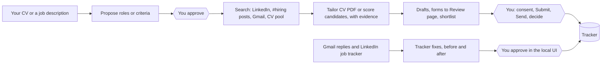

# Hirepair

**One agent for both sides of hiring.** Give it your CV and it finds and prepares jobs for you, inside your own LinkedIn. Give it a job description and it screens candidates for you. You approve every sensitive step.

[Türkçe README](README.tr.md) · [Scripts](docs/scripts.md) · [Roadmap](docs/roadmap.md) · MIT

---

## Why this exists

Applying to dozens of roles by hand is the same loop every day: scan listings, tailor the CV, fill forms, check mail, update a spreadsheet, and lose track of what went where. Hirepair automates the repetitive part of that loop and stops wherever a person must decide. The same engine also works for the other side of the table: a recruiter with a pile of CVs.

**Credit where it is due.** Hirepair grew out of [career-ops](https://github.com/career-ops-hq/career-ops) by [@santifer](https://github.com/santifer) and its contributors (MIT): the pipeline idea, the tracker mindset and the "evaluate, then apply" discipline come from there. Hirepair does not copy its code. career-ops is the more complete system for scanning company job boards, cover letters, interview and offer preparation; if that is what you need, start there and give it a star. Hirepair focuses on what career-ops leaves out:

- **Working inside LinkedIn, in your own signed-in browser:** job search, Easy Apply up to the Review page, #hiring posts, LinkedIn's own job tracker and your profile skills
- **Recruiter mode:** screening candidates against approved criteria, with masking and evidence checks
- **A tracker that stays true:** mail and LinkedIn signals are matched with your tracker, and every change waits for your one-click approval
- **No installs:** Python standard library and the Chrome you already use

## What it does

| | Job seeker `/start-job-agent` | Recruiter `/screen-candidates` |
|---|---|---|
| You give | Your CV | A job description |
| It proposes | 3-5 roles that fit, with CV evidence | Must-have / nice-to-have / exclusion criteria |
| You approve | The roles | The criteria |
| It then | Searches LinkedIn and #hiring posts, tailors an **ATS-compliant CV PDF per job**, fills Easy Apply up to Review, drafts mails, and keeps the tracker in step with Gmail and LinkedIn | Reads CVs from **a CV pool folder**, Gmail applications, or your own LinkedIn postings; ranks with evidence quotes |
| You still do | Consent boxes, IDs, Submit, Send | Every decision; it never rejects or contacts anyone |

Nothing runs before you approve the roles (or the criteria). Missing facts are marked `not_stated`, never guessed.

## Minimum requirements

1. [Claude Code](https://claude.com/claude-code) (the commands and prompts run as Claude Code commands and skills)
2. **Google Chrome** with the **Claude in Chrome** extension, and **you signed in to LinkedIn on your own account** (the agent never types passwords). Chrome also prints the CV PDFs
3. A **Gmail connector** so it can read replies and create drafts (send permission is not needed)
4. **Python 3** (standard library only) for the helper scripts the prompts call
5. Your CV as a file in this folder. Markdown or text works best; for a PDF the agent needs a PDF-to-text tool (on macOS `brew install poppler`), otherwise paste the text

Node.js is needed only to run the browser-script tests.

## Quick start

```bash
git clone <your-fork-url> hirepair
cd hirepair
claude
```

Then type one of:

```
/start-job-agent      # I am looking for a job
/screen-candidates    # I am hiring
/linkedin-profile     # which skills do jobs ask for, and what to fix on my LinkedIn
```

The agent asks for your CV (or the job description), proposes roles (or criteria), asks about daily limits, and waits for your yes. Your data lives in git-ignored files: `cv.local.md`, `profile.local.yml`, `tracker.md` and `data/`.

**Optional: install as a skill** so `/hirepair` works from any folder of yours (it only runs inside a Hirepair folder and asks for its path otherwise):

```bash
python3 scripts/install_skill.py            # symlinks skills/hirepair into ~/.claude/skills
python3 scripts/install_skill.py --uninstall
```

The skill reads prompts and docs from this repo, so keep the repo in place.

## A day with Hirepair

| When | Who | What happens |
|---|---|---|
| 17:00 | Agent (daily scan) | Reads LinkedIn's job tracker first: your applications, drafts, saved jobs and LinkedIn's signals. Then searches listings and #hiring posts, drops what you already handled, scores what is left, tailors CVs and fills Easy Apply forms up to Review |
| 09:00 | Agent (reply check) | Reads application mails (read only), writes replies into the tracker and proposes tracker fixes |
| Any time | You | Open the local UI: approve or edit the waiting items, then press Submit or Send yourself where it says so |

Run both once while you watch before you schedule them (see [Schedule it](#schedule-it-optional)).

## Highlights

**Inside LinkedIn**
- **Search that skips what you handled:** a results page is read in one call (`linkedin_cards.js`) and `card_filter.py` drops applied, seen, tracked and off-target cards before anything is clicked
- **#hiring posts:** `linkedin_posts.js` reads post search results with age, public e-mail and keyword match, and drops reposts of the same opening
- **Easy Apply up to Review:** the tailored PDF is uploaded, prefilled answers are checked against your CV, "Follow company" is unticked; the agent stops before Submit and saves a draft
- **LinkedIn's own job tracker:** `linkedin_myjobs.js` reads your applied, interview, draft, "clicked apply" and saved jobs. LinkedIn's signals (application viewed, resume downloaded, posting closed) go into your tracker, and jobs you saved, even from your phone, are scored in the next scan
- **Profile and skills:** `/linkedin-profile` reads your profile skills (`linkedin_skills.js`, read only), compares them with your CV and the market, drafts headline, About and skill changes from CV facts, and types each approved change into the edit box; you press Save

**CVs that pass ATS**
- Tailored per job from facts in your CV only: single column, standard headings and dates, at most 2 pages. `ats_check.py` checks the rules and reports missing keywords (it never adds any); `build_cv_pdf.py` prints a selectable-text PDF with your local Chrome and refuses more than 2 pages. Rules: [docs/ats-rules.md](docs/ats-rules.md)

**A tracker that stays true**
- A plain Markdown file ([format](docs/tracker-format.md)). `reply_reconcile.py` matches mail and LinkedIn events with its rows: replies are written directly; a row still waiting although it went out, or an application you sent yourself with no row, comes back as a before → after card for your approval. Old closed rows move to `tracker-archive.md`; dedupe reads both

**Skills from real listings**
- Every job text the scan reads is saved locally. `skill_gap.py` counts what the market asks for and compares it with your CV and LinkedIn skills; it suggests only skills your CV states and lists the rest as gaps, never adding them. `skill_queries.py` proposes skill-based search queries from the same data

**Local UI (optional)**
- `python3 scripts/ui_server.py` opens a page on 127.0.0.1 only: Today, Waiting for you (approval cards, before → after), Tracker (sort, filter, pages, a banner for tracker fixes), Skills, Recruiter. Consents, sign-in and the final Submit always stay yours. Details: [docs/ui-design.md](docs/ui-design.md)

**Recruiter mode**
- Point it at a folder of CVs, Gmail applications or applicants of your own LinkedIn postings. Protected attributes (age, gender, nationality, photo, name origin...) are masked before scoring, evidence quotes are checked against the masked CVs, and `criteria_rarity.py` shows which must-haves almost nobody in the pool meets. Advisory only: [docs/recruiter-mode.md](docs/recruiter-mode.md)

**Limits and safety**
- Daily limits you choose (scans, jobs evaluated and prepared per round); mail drafts only, never sending ([examples](templates/emails/README.md)); page and mail content treated as untrusted data; all data on your machine
- **Turkish market:** Turkish prompts in `prompts/tr/`, KVKK-aware consent steps, net/gross salary care, notes on local portal pitfalls and Workday

Every script, with its command line: [docs/scripts.md](docs/scripts.md).

## What you must do yourself

Passwords, payment details and government ID numbers are never entered by the agent. It also stops for CAPTCHAs, account creation, consent boxes (KVKK/GDPR/terms), InMail and connection requests, the final Submit and every Send. LinkedIn profile changes are typed into the edit box only after your yes, and you press Save.

## Permissions to grant (nothing more)

| Grant | Why |
|---|---|
| Chrome access to `linkedin.com` and the job portals you choose | Search listings, read your job tracker and profile skills, open application forms |
| Gmail read | Reply check |
| Gmail create draft | Drafts for you to review |
| File access to this one folder | Read CV, write profile, tracker, tailored PDFs |

Keep Gmail **send off**, or approval-gated. Page and mail content is treated as untrusted data.

## How it works



Details: [prompts/onboarding.md](prompts/onboarding.md), [prompts/daily-scan.md](prompts/daily-scan.md), [prompts/gmail-reply-check.md](prompts/gmail-reply-check.md), [prompts/linkedin-profile.md](prompts/linkedin-profile.md), [recruiter mode and limits](docs/recruiter-mode.md), [safety rules](docs/safety-rules.md), [candidate screening safety](docs/candidate-screening-safety.md), [automation notes](docs/automation-notes.md), [lessons learned](docs/lessons-learned.md).

## Schedule it (optional)

After one supervised run, create two Claude Code scheduled tasks: the daily scan (about 17:00, `prompts/daily-scan.md`) and the Gmail reply check (about 09:00, `prompts/gmail-reply-check.md`). Scheduled runs only prepare; they stop at every approval point. Keep the machine awake during the scan: a sleeping machine ends the browser session.

## Tests

```bash
python3 -m unittest discover -s tests
```

The browser scripts are tested in Node against fixtures built from the LinkedIn layouts seen in November 2026; those tests are skipped when Node is missing.

## Roadmap

What works, what is still untested on a real account, and what comes next: [docs/roadmap.md](docs/roadmap.md).

## Disclaimer

Use at your own risk. Automating LinkedIn or other sites may violate their terms and can get accounts restricted; use your own account at low volume and follow local law, including KVKK/GDPR. LinkedIn changes its pages without notice: when a reader returns nothing, check [docs/automation-notes.md](docs/automation-notes.md). The job-seeker flow was run on a real account in November 2026; the recruiter LinkedIn search assistant and the Gmail candidate source were tried only on fictional data, so review every result. Candidates are real people: a human makes every decision. Not affiliated with LinkedIn, Google, Anthropic or career-ops.

## License

MIT, see [LICENSE](LICENSE).
