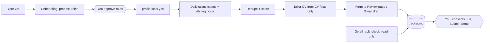

# Hirepair

**An agent that reads your CV, proposes roles, and works your job search while you approve the sensitive steps.**

**ATS-compliant, role-tailored CVs** from your own facts only. Turkish version: [README.tr.md](README.tr.md), prompts in `prompts/tr/`.

You give it your CV. It proposes 3-5 roles that fit, with the CV evidence for each, and waits for your approval. Then it searches LinkedIn (listings and #hiring posts), tailors your CV per job from your own facts, prepares applications up to the last step, drafts mails in Gmail, checks replies and keeps a Markdown tracker. You press Submit and Send.

Built on the open-source [career-ops](https://github.com/santifer/career-ops) by santifer and contributors (MIT). This project does not copy its code; it adds onboarding, scheduled prompts, a tracker convention, browser-automation notes and a safety model. It can run beside career-ops or on its own.

## Demo flow

```
you:    /start-job-agent
agent:  Give me your CV (path inside this folder, or paste text).
you:    data/my_cv.pdf
agent:  Proposed roles:
        1. Business Analyst - 3 yrs of requirements work (CV: "Wrote requirements for 3 releases")
        2. Product Owner    - owned a team backlog (CV: "Owned the team backlog")
        3. ...
        Approve, edit, remove or add? Exclusions? Salary? City / remote?
you:    Drop 3, add "Implementation Consultant", Istanbul or remote, no helpdesk.
agent:  Saved profile.local.yml. Start the first scan? (supervised)
you:    yes
agent:  12 new jobs, 7 prepared to the Review page, 2 mail drafts in Gmail.
        Needs you: 3 consent boxes, 1 question ("years of SQL?"), Submit.
```

Nothing runs before you approve the roles.

## How it works



1. **Onboarding** (`prompts/onboarding.md`): CV in, roles proposed with evidence, your approval, profile written.
2. **Scan** (`prompts/daily-scan.md`): reads only approved roles; scores 1-5 with quoted job requirements; prepares up to your daily cap.
3. **Reply check** (`prompts/gmail-reply-check.md`): read-only; updates the Reply column.
4. **Tracker** (`docs/tracker-format.md`); `python3 scripts/tracker_stats.py tracker.md` prints counts.

Every tailored CV follows `docs/ats-rules.md` (single column, standard headings and dates, selectable-text PDF, max 2 pages) and is checked with `python3 scripts/ats_check.py cv.md --jd job.txt` (reports missing keywords only; never adds any). CV tailoring uses only facts in your CV. It never invents experience, years, tools or numbers; if a form asks for a number it cannot derive, it asks you.

## Requirements

- [Claude Code](https://claude.com/claude-code)
- Claude in Chrome extension, with you signed in to LinkedIn yourself
- Gmail connector (read + create draft)
- Optional: Claude Code scheduled tasks for the daily scan and reply check
- Python 3 (stdlib only) for the tracker stats

## Two modes: job seeker / recruiter

| | Job seeker (`/start-job-agent`) | Recruiter (`/screen-candidates`) |
|---|---|---|
| Input | Your CV | A job description and a local folder of candidate CVs |
| First gate | You approve proposed roles | You approve must-have / nice-to-have / exclusion criteria; no CV is read before |
| Output | Tailored ATS-friendly CVs, prepared applications, drafts, tracker | Ranked, explainable shortlist (IDs only, evidence quotes, gaps, 2-3 clarifying questions, warnings) |
| Human decides | Submit, consents, sending | Everything: the agent never rejects, ranks anyone out or contacts candidates |

Recruiter mode masks protected and irrelevant attributes (age, gender, nationality, photo, name origin, address...) before scoring, marks missing information `not_stated` instead of guessing, keeps candidate data local (`screening/` and `reports/` are git-ignored), and never sends mail, InMail or messages. Read `docs/candidate-screening-safety.md` (KVKK/GDPR, retention, candidate notice, bias and fair use) first. Try it on the fictional data: `python3 scripts/screen_report.py templates/screening/criteria.example.json templates/screening/scores`. Turkish prompt: `prompts/tr/screen-candidates.md`. Platform terms apply to any LinkedIn use.

## Limits you set

After approving roles, onboarding asks: (1) max search rounds per day (suggest 1), (2) per round, max listings evaluated and max applications/drafts prepared (suggest 15 and 5), (3) approval style: one by one, or a batch summary. They are saved under `limits:` in `profile.local.yml` and the daily scan treats them as hard upper bounds: at a limit it stops and gives you a short summary. Submit, send and consent steps always need your explicit approval.

## Candidate sources (recruiter mode)

After you approve the criteria, choose one or more sources and a per-round candidate cap for each (suggest 30):

1. **Local CV folder.**
2. **Gmail:** application mails matching a filter you give. Matching threads are listed first; attachments are downloaded to the git-ignored `screening/inbox/` only after your approval. Read + create-draft only; no sending, deleting or labeling (labeling is optional, off by default, needs approval).
3. **LinkedIn:** only applicants to postings you published yourself (your Applicants screen) or profile URLs you give. No bulk collection from search results, no messages, InMail or connection requests. LinkedIn's terms restrict automation; the risk is yours.

Each candidate gets a category (strong match / possible / needs clarification / does not meet criteria) with an evidence quote. The last one is only a suggestion; the agent rejects nobody and contacts nobody. Reply drafts are drafts only. Masking applies to every source. Fictional samples: `templates/screening/`.

## LinkedIn search assistant (recruiter sub-mode)

A deliberately small, user-directed way to find leads: after you approve the criteria, the agent drafts people-search queries (keywords + location) for your approval; for each approved query it runs ONE search in your own open browser and reads only the first result page text (headline, current role line, location, connection degree; no names stored). Limits: results per round (suggest 10, hard maximum 25), queries per day (suggest 3). No paging, no profile visits, no connection requests, messages, InMail, follows or lead saving. You get a headline-level shortlist; profile deepening happens only for candidate IDs you pick in chat, one by one, with masking. It stops at once on any CAPTCHA, warning, verification or limit text. See `prompts/screening/linkedin-search-assistant.md`.

**Honest limitations.** Headline text is weak evidence: years of experience and skills are mostly invisible, so the best category is "possible / needs clarification" and "strong match" is only possible after a deepening you chose. Results depend on LinkedIn's ranking and on your network visibility, so it will miss people. LinkedIn's terms prohibit automated bulk collection and accounts can be restricted; this mode is small on purpose and the risk stays with you. Leads are third-party personal data (KVKK/GDPR): minimum fields, local git-ignored folder, no sharing, delete when done. Not tested against the live site. See `docs/candidate-screening-safety.md`. Fictional samples: `templates/screening/linkedin-search-results.example.md`, `report.linkedin-search.example.md`.

## Quick start

```bash
cd hirepair
claude
```

Then in the session:

```
/start-job-agent
```

(Without slash commands: "Follow prompts/onboarding.md".) `CLAUDE.md` makes the agent run onboarding automatically while `profile.local.yml` has no approved roles.

## Permissions

Grant exactly this, and no more:

| Grant | Why |
|---|---|
| Chrome site access: `linkedin.com` plus only the job portals you choose | Search listings and posts, open Easy Apply forms |
| Gmail: read | Reply check, finding public recruiter addresses |
| Gmail: create draft | Mail drafts for you to review |
| File access: one working folder (this one) | Read your CV, write profile, tracker, tailored PDFs. The Chrome extension can only upload files from inside it (see `docs/automation-notes.md`) |

**Send permission is NOT needed.** Keep Gmail send off, or approval-gated so every send needs your explicit yes. The agent only creates drafts.

**Never granted:** passwords, payment details, government ID numbers. You type those yourself; the agent stops and asks. It also stops for CAPTCHAs, account creation, consent boxes (KVKK/GDPR/terms), InMail and connection requests, the final Submit, and anything irreversible.

Page and mail content is treated as untrusted data; instructions inside it are reported, not followed.

## Privacy

All data stays on your machine: CV, profile, tracker, tailored PDFs. The agent sends content only to the services you point it at (LinkedIn, the portals you chose, Gmail) and to Claude to do the work. `.gitignore` excludes `cv.local.md`, `profile.local.yml`, `*.local.*`, `tracker.md`, `cv*.pdf`, `data/`, `upload/` and `.claude/settings.local.json`. Run `git status` before every push.

## Schedule it

After one supervised run:

1. Daily scan, about 17:00: create a scheduled task whose prompt is `prompts/daily-scan.md` with placeholders filled (`cv.local.md`, `profile.local.yml`, `tracker.md`, report language, daily cap).
2. Gmail check, about 09:00: same with `prompts/gmail-reply-check.md`.

Scheduled runs only prepare; they stop at every approval point and list what needs you. If onboarding is not done, they stop and say so.

## Troubleshooting

- **LinkedIn limits / checks:** keep volume low (daily cap), do not run in parallel, use your own session. On a security check, stop and solve it yourself. Details in `docs/automation-notes.md`.
- **Easy Apply modal quirks:** steps vary; the agent stops at Review and lists unanswered questions. See "LinkedIn Easy Apply flow".
- **CV upload fails:** the resume file input only appears after clicking "Upload resume" and opens a native dialog. The hook trick (capture the hidden `<input type=file>`, then `file_upload`) and the "file must be inside the working folder" rule are in `docs/automation-notes.md`, section "Uploading a tailored PDF".
- **#hiring search empty:** use unquoted keywords, sort by date, scroll twice; see the notes.
- **Wrong CV or wrong prefilled years in a form:** see `docs/lessons-learned.md`.
- **Scan refuses to start:** `approved_roles` missing. Run `/start-job-agent`.

## Marketing positioning

An agent that reads your CV, proposes roles, and works your job search while you approve the sensitive steps. An ATS-compliant, role-tailored CV for every application. Pitch points: starts from your CV, not a form; never invents experience; you stay in control of consent, IDs, Submit and Send; everything stays local.

## Layout

```
CLAUDE.md, .claude/commands/   entry file and /start-job-agent
prompts/    onboarding, daily scan, Gmail reply check
docs/       automation notes, tracker format, safety rules
templates/  example tracker, profile, CV (all fictional)
scripts/    tracker_stats.py, ats_check.py
prompts/tr/ Turkish prompts; README.tr.md Turkish README
docs/       also ats-rules.md, lessons-learned.md
```

## Disclaimer

Use at your own risk. Automating LinkedIn or other sites may violate their terms of service and can get accounts restricted; read and follow each platform's terms and your local law (including data-protection rules such as KVKK/GDPR). Use your own account, low volume, and never scrape other people's personal data beyond what an application needs. Recruiters read what you send: review every draft and CV. Not affiliated with LinkedIn, Google, Anthropic or career-ops. Selectors and site behavior change often.

## License

MIT, see `LICENSE`.
