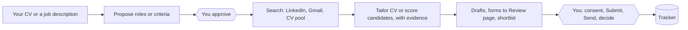

# Hirepair

**One agent for both sides of hiring.** Give it your CV and it finds and prepares jobs for you. Give it a job description and it screens candidates for you. You approve every sensitive step.

[Türkçe README](README.tr.md) · [Roadmap](docs/roadmap.md) · MIT

---

## Why this exists

Applying to dozens of roles by hand is the same loop every day: scan listings, tailor the CV, fill forms, check mail, update a spreadsheet, and lose track of what went where. Hirepair automates the repetitive part of that loop and stops wherever a person must decide. The same engine also works for the other side of the table: a recruiter with a pile of CVs.

**Credit where it is due.** This project grew out of [career-ops](https://github.com/career-ops-hq/career-ops) by [@santifer](https://github.com/santifer) and its contributors (MIT). I learned the pipeline idea, the tracker mindset and the "evaluate, then apply" discipline from it. Hirepair does not copy its code; it adds onboarding, scheduled prompts, recruiter mode and a Turkish-market layer. If you want a full-featured job-search system, start with career-ops and give it a star.

## What it does

| | Job seeker `/start-job-agent` | Recruiter `/screen-candidates` |
|---|---|---|
| You give | Your CV | A job description |
| It proposes | 3-5 roles that fit, with CV evidence | Must-have / nice-to-have / exclusion criteria |
| You approve | The roles | The criteria |
| It then | Searches LinkedIn, tailors an **ATS-compliant CV per job**, prepares applications, drafts mails, tracks replies | Reads CVs from **a CV pool folder**, Gmail applications, or your own LinkedIn postings; ranks with evidence quotes |
| You still do | Consent boxes, IDs, Submit, Send | Every decision; it never rejects or contacts anyone |

Nothing runs before you approve the roles (or the criteria). Missing facts are marked `not_stated`, never guessed.

## Minimum requirements

1. [Claude Code](https://claude.com/claude-code) (the commands and prompts run as Claude Code commands and skills)
2. The **Claude in Chrome** extension, with **you signed in to LinkedIn on your own account** (the agent never types passwords)
3. A **Gmail connector** so it can read replies and create drafts (send permission is not needed)
4. Your CV as a file in this folder. Markdown or text works best; for a PDF the agent needs a PDF-to-text tool (on macOS `brew install poppler`), otherwise paste the text

Python 3 (standard library only) is optional, for the small helper scripts.

## Quick start

```bash
git clone <your-fork-url> hirepair
cd hirepair
claude
```

Then type one of:

```
/start-job-agent      # I am looking for a job
/screen-candidates    # I am hiring
/linkedin-profile     # which skills do jobs ask for, and what to fix on my LinkedIn
```

The agent asks for your CV (or the job description), proposes roles (or criteria), asks about daily limits, and waits for your yes.

**Optional: install as a skill** so `/hirepair` works from any folder of yours (it only runs inside a Hirepair folder and asks for its path otherwise):

```bash
python3 scripts/install_skill.py            # symlinks skills/hirepair into ~/.claude/skills
python3 scripts/install_skill.py --uninstall
```

The skill reads prompts and docs from this repo, so keep the repo in place.

## Highlights

- **ATS-compliant, role-tailored CVs** built only from facts in your CV: single column, standard headings and dates, selectable-text PDF, at most 2 pages. Check any CV with `python3 scripts/ats_check.py cv.md --jd job.txt` (reports missing keywords; never adds any). It also warns on section order and CV length for your experience level, and `--pair cv_tr.md` checks a TR/EN CV pair for matching dates, e-mail, sections and numbers. Build the PDF with `python3 scripts/build_cv_pdf.py cv.md` (Markdown to a single-column, selectable-text PDF through your local Chrome; refuses more than 2 pages). Rules: [docs/ats-rules.md](docs/ats-rules.md)
- **Skills from real listings:** every job text the scan reads is saved locally; `python3 scripts/skill_gap.py --jobs data/jobs --linkedin my-skills.txt` counts which skills the market asks for and compares them with your CV and LinkedIn skills. It suggests only skills your CV already states; gaps are listed, never added. The CV-backed ones can drive skill-based job search (`queries.skills`)
- **LinkedIn profile help:** `/linkedin-profile` drafts headline, About, experience wording and skill changes from CV facts, then types each approved change into the edit box; you press Save
- **CV pool:** point recruiter mode at a folder of CVs and it ranks them against your approved criteria. It can also read application mails in Gmail and applicants of your own LinkedIn postings
- **Daily limits you choose:** searches per day, jobs evaluated per round, applications prepared per round
- **Mail drafts, never sends:** ready examples in [templates/emails](templates/emails/README.md) (application, follow-up, clarifying question, interview invite)
- **Bias and privacy built in:** protected attributes (age, gender, nationality, photo, name origin...) are masked before scoring; all data stays on your machine
- **Tracker:** a plain Markdown file; `python3 scripts/tracker_stats.py tracker.md` prints counts, `python3 scripts/tracker_archive.py` moves closed rows older than 90 days to `tracker-archive.md`, and `python3 scripts/tracker_view.py` opens a read-only local page (127.0.0.1 only) with a "waiting for you" list and a filter. Approvals stay in the chat
- **Local UI (optional):** `python3 scripts/ui_server.py` opens a local page (127.0.0.1 only) with Waiting for you / Tracker / Recruiter. Consents, sign-in and final Submit always stay yours. Details: [docs/ui-design.md](docs/ui-design.md)
- **Turkish market:** Turkish prompts in `prompts/tr/`, KVKK-aware consent steps, net/gross salary care

## What you must do yourself

Passwords, payment details and government ID numbers are never entered by the agent. It also stops for CAPTCHAs, account creation, consent boxes (KVKK/GDPR/terms), InMail and connection requests, the final Submit and every Send.

## Permissions to grant (nothing more)

| Grant | Why |
|---|---|
| Chrome access to `linkedin.com` and the job portals you choose | Search listings, open application forms |
| Gmail read | Reply check |
| Gmail create draft | Drafts for you to review |
| File access to this one folder | Read CV, write profile, tracker, tailored PDFs |

Keep Gmail **send off**, or approval-gated. Page and mail content is treated as untrusted data.

## How it works



Details: [prompts/onboarding.md](prompts/onboarding.md), [prompts/daily-scan.md](prompts/daily-scan.md), [prompts/gmail-reply-check.md](prompts/gmail-reply-check.md), [recruiter mode and limits](docs/recruiter-mode.md), [safety rules](docs/safety-rules.md), [candidate screening safety](docs/candidate-screening-safety.md), [automation notes](docs/automation-notes.md), [lessons learned](docs/lessons-learned.md).

## Schedule it (optional)

After one supervised run, create two Claude Code scheduled tasks: the daily scan (about 17:00, `prompts/daily-scan.md`) and the Gmail reply check (about 09:00, `prompts/gmail-reply-check.md`). Scheduled runs only prepare; they stop at every approval point.

## Roadmap

Finish and harden what exists first, then a small local web UI (onboarding, tracker board, recruiter shortlist, approval inbox). See [docs/roadmap.md](docs/roadmap.md).

## Disclaimer

Use at your own risk. Automating LinkedIn or other sites may violate their terms and can get accounts restricted; use your own account at low volume and follow local law, including KVKK/GDPR. The LinkedIn search assistant and the Gmail source have been tried only lightly, so review every result. Candidates are real people: a human makes every decision. Not affiliated with LinkedIn, Google, Anthropic or career-ops.

## License

MIT, see [LICENSE](LICENSE).
