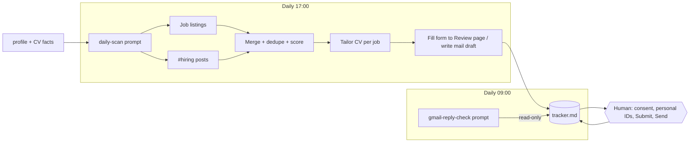

# claude-job-agent

A daily job-search loop for [Claude Code](https://claude.com/claude-code): two scheduled prompts, a plain-Markdown tracker, and written-down lessons for driving a real browser safely. The agent searches, scores, tailors a CV and prepares applications up to the last step. **You press Submit.**

## Built on career-ops

This project builds on the open-source [career-ops](https://github.com/career-ops-hq/career-ops) by santifer and its contributors (MIT). career-ops provides the evaluation modes, CV generation, tracker tooling and data contract. claude-job-agent does not copy that code. It adds the pieces that sat around it in one real daily setup:

- scheduled-task prompts that run the whole loop unattended (daily scan, morning reply check),
- a tracker convention shared by those prompts,
- notes on automating LinkedIn and company portals through Claude in Chrome,
- a safety model for running that unattended.

Use it next to career-ops (point the CV and profile paths at your career-ops files), or on its own with any CV builder.

## Architecture



## How the loop works

1. **Scan** (`prompts/daily-scan.md`). Runs once a day. Searches job listings and "#hiring" posts in one pass, merges them into one pool, removes anything already in the tracker or the seen-ID list, and scores each job 1-5 against a rubric (role type, domain, seniority gap, location, freshness/competition, company signal). Every score must quote requirements from the job text that match the CV.
2. **Prepare.** For jobs at 3.0+, up to a daily cap: tailor a CV using only facts in your CV file, fill the application form up to the review page, or write a short mail/message draft. Nothing is submitted or sent.
3. **Record.** One row per item is appended to the tracker (`docs/tracker-format.md`).
4. **Reply check** (`prompts/gmail-reply-check.md`). Next morning, a read-only pass over recent mail updates the Reply column (interview invite, rejection, info request, received).
5. **You** review the report, give consents, answer personal fields, submit, and send drafts you approve.

`scripts/tracker_stats.py` prints status and channel counts from the tracker.

## Setup

Requirements: Claude Code with scheduled tasks, the Claude in Chrome extension (signed in to the sites you use), and a mail connector if you want drafts and reply checks.

1. Copy `templates/cv.example.md` to your own CV file and replace it with your real CV. It is the only source of facts the agent may use.
2. Copy `templates/profile.example.yml` to `profile.local.yml` and fill in targets, exclusions, locations, salary and form facts.
3. Copy `templates/tracker.example.md` to `tracker.md` and delete the fake rows.
4. Copy the two prompts into scheduled tasks (one at about 17:00, one at about 09:00) and replace every `<PLACEHOLDER>` with your local paths and a CV build command.
5. Do a supervised first run before scheduling it. Read `docs/safety-rules.md` and `docs/automation-notes.md` first.

Your real CV, tracker, tailored PDFs and profile are git-ignored (see `.gitignore`). Check `git status` before every push.

## Safety and ethics

- The agent never enters passwords, ID numbers or payment data, never solves CAPTCHAs, never ticks consent boxes, never creates accounts, never clicks the final Submit, and never sends mail or messages.
- It never fabricates CV facts. Missing requirements are left out, not invented, and years-of-experience gaps are stated in the score rather than hidden.
- Content from job sites and mail is treated as untrusted data. Instructions inside it are reported, not followed.
- Volume is capped and paced. Use your own session, follow each site's terms, and do not collect other people's personal data beyond what a job application needs.
- Recruiters read what you send. Tailoring is not a license to exaggerate; read every draft before you send it.

Full list: `docs/safety-rules.md`.

## Human stays in the loop

| Agent does | You do |
|---|---|
| Search, dedupe, score | Decide which jobs you actually want |
| Tailor CV from your facts | Check the CV is true and fits |
| Fill forms to the review page | Consent boxes, personal ID fields, accounts, CAPTCHAs |
| Write mail and message drafts | Read, edit, send |
| Update the tracker and reply column | Final Submit and status |

## Layout

```
prompts/    scheduled-task prompts (genericized)
docs/       automation notes, tracker format, safety rules
templates/  example tracker, profile, CV (all fictional)
scripts/    tracker_stats.py (stdlib only)
```

## Status

Personal project shared as-is; selectors and site behavior change often, so treat `docs/automation-notes.md` as lessons, not guarantees. Not affiliated with LinkedIn, Anthropic or career-ops.

## License

MIT, see `LICENSE`.
