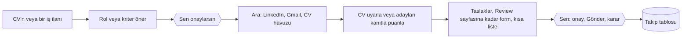

# Hirepair

**İşe alımın iki tarafı için tek ajan.** CV'ni ver, senin için iş bulsun ve hazırlasın. İş ilanı ver, senin için adayları taransın. Hassas her adımı sen onaylarsın.

[English README](README.md) · [Yol haritası](docs/roadmap.md) · MIT

---

## Neden var?

Onlarca ilana elle başvurmak her gün aynı döngüdür: ilanları tara, CV'yi uyarla, formları doldur, mailleri kontrol et, tabloyu güncelle ve neyin nereye gittiğini kaybet. Hirepair bu döngünün tekrar eden kısmını otomatikleştirir ve bir insanın karar vermesi gereken her yerde durur. Aynı motor masanın öbür tarafı için de çalışır: elinde CV yığını olan bir işe alımcı.

**Emeği geçene saygı.** Bu proje, [@santifer](https://github.com/santifer) ve katkıcılarının [career-ops](https://github.com/career-ops-hq/career-ops) (MIT) projesinden beslenerek ortaya çıktı. Hat fikrini, takip tablosu yaklaşımını ve "önce değerlendir, sonra başvur" disiplinini oradan öğrendim. Hirepair onun kodunu kopyalamaz; onboarding, zamanlanmış promptlar, işe alım modu ve Türkiye katmanını ekler. Tam kapsamlı bir iş arama sistemi istiyorsan career-ops ile başla ve bir yıldız ver.

## Ne yapar?

| | İş arayan `/start-job-agent` | İşe alımcı `/screen-candidates` |
|---|---|---|
| Sen verirsin | CV'ni | Bir iş ilanı |
| O önerir | CV kanıtıyla 3-5 uygun rol | Olmazsa olmaz / olursa iyi / dışlama kriterleri |
| Sen onaylarsın | Rolleri | Kriterleri |
| Sonra | LinkedIn'de arar, her ilana **ATS uyumlu özel CV** hazırlar, başvuruları hazırlar, mail taslağı yazar, yanıtları takip eder | **CV havuzu klasöründen**, Gmail başvurularından veya kendi LinkedIn ilanlarından adayları okur; kanıt alıntısıyla sıralar |
| Sen yaparsın | Onay kutuları, kimlik bilgileri, Gönder | Her karar; ajan kimseyi reddetmez, kimseyle iletişime geçmez |

Roller (veya kriterler) onaylanmadan hiçbir şey çalışmaz. Eksik bilgi `not_stated` yazılır, tahmin edilmez.

## Minimum gereksinimler

1. [Claude Code](https://claude.com/claude-code) (komutlar ve promptlar Claude Code komutu ve skill'i olarak çalışır)
2. **Claude in Chrome** eklentisi; **LinkedIn'e kendi hesabınla sen giriş yapmış olmalısın** (ajan asla parola yazmaz)
3. Yanıtları okumak ve taslak oluşturmak için **Gmail bağlantısı** (gönderme izni gerekmez)
4. CV'n bu klasörde bir dosya olarak

Küçük yardımcı scriptler için Python 3 (yalnızca standart kütüphane) isteğe bağlıdır.

## Hızlı başlangıç

```bash
git clone <fork-adresin> hirepair
cd hirepair
claude
```

Sonra birini yaz:

```
/start-job-agent      # iş arıyorum
/screen-candidates    # işe alım yapıyorum
```

Ajan CV'ni (veya iş ilanını) ister, rolleri (veya kriterleri) önerir, günlük limitleri sorar ve senin onayını bekler.

## Öne çıkanlar

- CV'nde bulunan gerçek bilgilerden üretilen **ATS uyumlu, role özel CV**: tek sütun, standart başlık ve tarih, metni seçilebilir PDF, en fazla 2 sayfa. Herhangi bir CV'yi `python3 scripts/ats_check.py cv.md --jd ilan.txt` ile kontrol et (eksik anahtar kelimeyi raporlar, hiçbirini eklemez). Ayrıca bölüm sırasını ve deneyim düzeyine göre CV uzunluğunu uyarır; `--pair cv_en.md` ile TR/EN CV çiftinde tarih, e-posta, bölüm ve sayıların tutarlılığını denetler. Kurallar: [docs/ats-rules.md](docs/ats-rules.md)
- **CV havuzu:** işe alım modunu bir CV klasörüne yönlendir; onayladığın kriterlere göre sıralar. Gmail'deki başvuru maillerini ve kendi LinkedIn ilanlarının başvurularını da okuyabilir
- **Seçtiğin günlük limitler:** günlük arama, turda değerlendirilecek ilan, turda hazırlanacak başvuru
- **Mail taslağı, asla gönderme:** [templates/emails](templates/emails/README.md) içinde hazır örnekler (başvuru, takip, netleştirme sorusu, görüşme daveti)
- **Önyargı ve gizlilik içeride:** korunan özellikler (yaş, cinsiyet, uyruk, fotoğraf, isim kökeni...) puanlamadan önce maskelenir; tüm veri senin makinende kalır
- **Takip tablosu:** düz bir Markdown dosyası; `python3 scripts/tracker_stats.py tracker.md` sayıları verir
- **Türkiye piyasası:** `prompts/tr/` içinde Türkçe promptlar, KVKK onay adımları, net/brüt maaş uyarısı

## Senin yapman gerekenler

Parola, ödeme bilgisi ve kimlik numarasını ajan asla girmez. CAPTCHA, hesap oluşturma, onay kutuları (KVKK/GDPR/koşullar), InMail ve bağlantı isteği, son Gönder ve her mail gönderimi için de durur.

## Verilecek izinler (fazlası değil)

| İzin | Neden |
|---|---|
| `linkedin.com` ve seçtiğin iş portalları için Chrome erişimi | İlan arama, başvuru formu açma |
| Gmail okuma | Yanıt kontrolü |
| Gmail taslak oluşturma | İncelemen için taslaklar |
| Yalnızca bu klasöre dosya erişimi | CV okuma, profil, takip tablosu, özel PDF'ler yazma |

Gmail **gönderme** iznini kapalı tut ya da her gönderimde onay iste. Sayfa ve mail içeriği güvenilmeyen veri olarak ele alınır.

## Nasıl çalışır?



Ayrıntılar: [prompts/tr/onboarding.md](prompts/tr/onboarding.md), [prompts/tr/daily-scan.md](prompts/tr/daily-scan.md), [prompts/tr/gmail-reply-check.md](prompts/tr/gmail-reply-check.md), [işe alım modu ve limitler](docs/recruiter-mode.tr.md), [güvenlik kuralları](docs/safety-rules.md), [aday tarama güvenliği](docs/candidate-screening-safety.tr.md), [otomasyon notları](docs/automation-notes.md), [çıkarılan dersler](docs/lessons-learned.md).

## Zamanlama (isteğe bağlı)

Bir kez gözetimli çalıştırdıktan sonra iki Claude Code zamanlanmış görevi oluştur: günlük tarama (yaklaşık 17:00, `prompts/tr/daily-scan.md`) ve Gmail yanıt kontrolü (yaklaşık 09:00, `prompts/tr/gmail-reply-check.md`). Zamanlanmış çalıştırmalar yalnızca hazırlar; her onay noktasında durur.

## Yol haritası

Önce mevcut olanı bitirip sağlamlaştırıyoruz; sonra küçük bir yerel web arayüzü (onboarding, takip panosu, aday kısa listesi, onay kutusu). Bkz. [docs/roadmap.md](docs/roadmap.md).

## Yasal uyarı

Kullanım riski sana aittir. LinkedIn veya diğer sitelerde otomasyon kullanım şartlarını ihlal edebilir ve hesabın kısıtlanmasına yol açabilir; kendi hesabını düşük hacimle kullan, KVKK/GDPR dahil yerel mevzuata uy. LinkedIn arama yardımcısı ve Gmail kaynağı yalnızca hafifçe denendi, her sonucu gözden geçir. Adaylar gerçek insanlardır: her kararı bir insan verir. LinkedIn, Google, Anthropic veya career-ops ile bağlantılı değildir.

## Lisans

MIT, bkz. [LICENSE](LICENSE).
