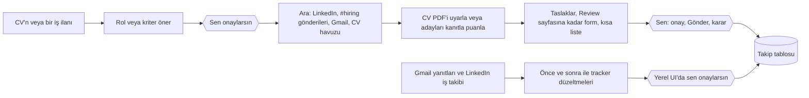

# Hirepair

**İşe alımın iki tarafı için tek ajan.** CV'ni ver, kendi LinkedIn'inin içinde senin için iş bulsun ve hazırlasın. İş ilanı ver, senin için adayları taransın. Hassas her adımı sen onaylarsın.

[English README](README.md) · [Scriptler](docs/scripts.tr.md) · [Yol haritası](docs/roadmap.md) · MIT

---

## Neden var?

Onlarca ilana elle başvurmak her gün aynı döngüdür: ilanları tara, CV'yi uyarla, formları doldur, mailleri kontrol et, tabloyu güncelle ve neyin nereye gittiğini kaybet. Hirepair bu döngünün tekrar eden kısmını otomatikleştirir ve bir insanın karar vermesi gereken her yerde durur. Aynı motor masanın öbür tarafı için de çalışır: elinde CV yığını olan bir işe alımcı.

**Emeği geçene saygı.** Hirepair, [@santifer](https://github.com/santifer) ve katkıcılarının [career-ops](https://github.com/career-ops-hq/career-ops) (MIT) projesinden beslenerek ortaya çıktı: hat fikri, takip tablosu yaklaşımı ve "önce değerlendir, sonra başvur" disiplini oradan gelir. Hirepair onun kodunu kopyalamaz. Şirket ilan panolarını tarama, ön yazı, mülakat ve teklif hazırlığı için career-ops daha kapsamlı bir sistemdir; ihtiyacın buysa oradan başla ve bir yıldız ver. Hirepair, career-ops'un dışında bıraktığı alanlara odaklanır:

- **LinkedIn'in içinde, kendi oturum açık tarayıcında çalışır:** iş arama, Review sayfasına kadar Easy Apply, #hiring gönderileri, LinkedIn'in kendi iş takibi ve profil yeteneklerin
- **İşe alımcı modu:** adayları onaylı kriterlere göre maskeleme ve kanıt kontrolüyle değerlendirir
- **Doğru kalan bir takip tablosu:** mail ve LinkedIn sinyalleri tracker ile eşleştirilir, her değişiklik tek tıkla onayını bekler
- **Kurulum yok:** Python standart kütüphanesi ve zaten kullandığın Chrome

## Ne yapar?

| | İş arayan `/start-job-agent` | İşe alımcı `/screen-candidates` |
|---|---|---|
| Sen verirsin | CV'ni | Bir iş ilanı |
| O önerir | CV kanıtıyla 3-5 uygun rol | Olmazsa olmaz / olursa iyi / dışlama kriterleri |
| Sen onaylarsın | Rolleri | Kriterleri |
| Sonra | LinkedIn'de ve #hiring gönderilerinde arar, her ilana **ATS uyumlu özel CV PDF'i** hazırlar, Easy Apply'ı Review'a kadar doldurur, mail taslağı yazar, tracker'ı Gmail ve LinkedIn ile güncel tutar | **CV havuzu klasöründen**, Gmail başvurularından veya kendi LinkedIn ilanlarından adayları okur; kanıt alıntısıyla sıralar |
| Sen yaparsın | Onay kutuları, kimlik bilgileri, Gönder | Her karar; ajan kimseyi reddetmez, kimseyle iletişime geçmez |

Roller (veya kriterler) onaylanmadan hiçbir şey çalışmaz. Eksik bilgi `not_stated` yazılır, tahmin edilmez.

## Minimum gereksinimler

1. [Claude Code](https://claude.com/claude-code) (komutlar ve promptlar Claude Code komutu ve skill'i olarak çalışır)
2. **Google Chrome** ve **Claude in Chrome** eklentisi; **LinkedIn'e kendi hesabınla sen giriş yapmış olmalısın** (ajan asla parola yazmaz). CV PDF'lerini de Chrome yazdırır
3. Yanıtları okumak ve taslak oluşturmak için **Gmail bağlantısı** (gönderme izni gerekmez)
4. Promptların çağırdığı yardımcı scriptler için **Python 3** (yalnızca standart kütüphane)
5. CV'n bu klasörde bir dosya olarak. En iyisi Markdown veya metin; PDF için ajanın PDF'ten metne çeviren bir araca ihtiyacı var (macOS'ta `brew install poppler`), yoksa metni yapıştır

Node.js yalnızca tarayıcı scriptlerinin testleri için gerekir.

## Hızlı başlangıç

```bash
git clone <fork-adresin> hirepair
cd hirepair
claude
```

Sonra birini yaz:

```
/start-job-agent      # iş arıyorum
/screen-candidates    # işe alım yapıyorum
/linkedin-profile     # ilanlar hangi yetenekleri istiyor, LinkedIn'imde ne düzelmeli
```

Ajan CV'ni (veya iş ilanını) ister, rolleri (veya kriterleri) önerir, günlük limitleri sorar ve senin onayını bekler. Verilerin git'e girmeyen dosyalarda durur: `cv.local.md`, `profile.local.yml`, `tracker.md` ve `data/`.

**İsteğe bağlı: skill olarak kur.** Böylece `/hirepair` her klasörden çalışır (yalnızca bir Hirepair klasöründe çalışır, değilse yolunu sorar):

```bash
python3 scripts/install_skill.py            # skills/hirepair'i ~/.claude/skills altına sembolik bağlar
python3 scripts/install_skill.py --uninstall
```

Skill, prompt ve dokümanları bu repodan okur; repoyu yerinden oynatma.

## Hirepair ile bir gün

| Ne zaman | Kim | Ne olur |
|---|---|---|
| 17:00 | Ajan (günlük tarama) | Önce LinkedIn'in iş takibini okur: başvuruların, taslakların, kaydettiğin ilanlar ve LinkedIn sinyalleri. Sonra ilanları ve #hiring gönderilerini arar, zaten ilgilendiklerini eler, kalanları puanlar, CV'leri uyarlar ve Easy Apply formlarını Review'a kadar doldurur |
| 09:00 | Ajan (yanıt kontrolü) | Başvuru maillerini okur (salt okunur), yanıtları tracker'a yazar ve tracker düzeltmeleri önerir |
| İstediğin zaman | Sen | Yerel UI'ı açarsın: bekleyenleri onaylar ya da düzenlersin, sonra gereken yerde Gönder'e kendin basarsın |

Zamanlamadan önce ikisini de bir kez başında durarak çalıştır (bkz. [Zamanlama](#zamanlama-isteğe-bağlı)).

## Öne çıkanlar

**LinkedIn'in içinde**
- **Zaten ilgilendiklerini atlayan arama:** sonuç sayfası tek çağrıda okunur (`linkedin_cards.js`), `card_filter.py` başvurulan, görülen, tracker'da olan ve hedef dışı kartları hiçbir şeye tıklanmadan eler
- **#hiring gönderileri:** `linkedin_posts.js` gönderi aramasını yaş, açık e-posta ve anahtar kelime eşleşmesiyle okur; aynı ilanın tekrar paylaşımlarını atar
- **Review'a kadar Easy Apply:** özel PDF yüklenir, hazır gelen cevaplar CV'ne göre kontrol edilir, "Şirketi takip et" kaldırılır; ajan Gönder'den önce durur ve taslağı kaydeder
- **LinkedIn'in kendi iş takibi:** `linkedin_myjobs.js` başvurduğun, mülakattaki, taslak, şirket sitesine gidilen ve kaydettiğin ilanları okur. LinkedIn sinyalleri (başvuru görüntülendi, CV indirildi, ilan kapandı) tracker'a yazılır; kaydettiğin ilanlar (telefondan da) bir sonraki taramada puanlanır
- **Profil ve yetenekler:** `/linkedin-profile` profil yeteneklerini okur (`linkedin_skills.js`, salt okunur), CV'n ve piyasayla karşılaştırır, başlık, Hakkında ve yetenek değişikliklerini CV gerçeklerinden taslaklar, onaylanan her değişikliği düzenleme kutusuna yazar; Kaydet'e sen basarsın

**ATS'den geçen CV'ler**
- Her ilana yalnızca CV'ndeki gerçeklerden uyarlanır: tek sütun, standart başlık ve tarih, en fazla 2 sayfa. `ats_check.py` kuralları denetler ve eksik anahtar kelimeyi raporlar (hiçbirini eklemez); `build_cv_pdf.py` yerel Chrome ile metni seçilebilir PDF üretir, 2 sayfayı aşarsa reddeder. Kurallar: [docs/ats-rules.tr.md](docs/ats-rules.tr.md)

**Doğru kalan bir takip tablosu**
- Düz bir Markdown dosyası ([biçim](docs/tracker-format.md)). `reply_reconcile.py` mail ve LinkedIn olaylarını satırlarla eşleştirir: yanıtlar doğrudan yazılır; gönderildiği hâlde beklemede görünen bir satır ya da satırı olmayan, kendin gönderdiğin bir başvuru, onaylaman için önce → sonra kartı olarak gelir. Eski kapanmış satırlar `tracker-archive.md`'ye taşınır; tekrar kontrolü ikisini de okur

**Gerçek ilanlardan yetenekler**
- Taramanın okuduğu her ilan metni yerelde saklanır. `skill_gap.py` piyasanın ne istediğini sayar, CV'n ve LinkedIn yeteneklerinle karşılaştırır; yalnızca CV'nde yazan yetenekleri önerir, gerisini açık olarak listeler, asla eklemez. `skill_queries.py` aynı veriden yeteneğe dayalı arama sorguları önerir

**Yerel UI (isteğe bağlı)**
- `python3 scripts/ui_server.py` yalnızca 127.0.0.1'de bir sayfa açar: Bugün, Seni bekleyenler (onay kartları, önce → sonra), Takip (sıralama, süzme, sayfalar, tracker düzeltmeleri için uyarı), Yetenekler, İşe alımcı. KVKK/onay kutuları, giriş ve son Gönder her zaman sende kalır. Ayrıntı: [docs/ui-design.tr.md](docs/ui-design.tr.md)

**İşe alımcı modu**
- Bir CV klasörüne, Gmail başvurularına ya da kendi LinkedIn ilanlarının başvurularına yönlendir. Korunan özellikler (yaş, cinsiyet, uyruk, fotoğraf, isim kökeni...) puanlamadan önce maskelenir, kanıt alıntıları maskeli CV'lerle doğrulanır, `criteria_rarity.py` havuzda neredeyse kimsenin karşılamadığı zorunlu kriterleri gösterir. Yalnızca tavsiye: [docs/recruiter-mode.tr.md](docs/recruiter-mode.tr.md)

**Limitler ve güvenlik**
- Seçtiğin günlük limitler (tarama, turda değerlendirilen ve hazırlanan ilan); yalnızca mail taslağı, asla gönderme ([örnekler](templates/emails/README.md)); sayfa ve mail içeriği güvenilmeyen veri sayılır; tüm veri senin makinende kalır
- **Türkiye piyasası:** `prompts/tr/` içinde Türkçe promptlar, KVKK onay adımları, net/brüt maaş uyarısı, yerel portal tuzakları ve Workday notları

Tüm scriptler ve komut satırları: [docs/scripts.tr.md](docs/scripts.tr.md).

## Senin yapman gerekenler

Parola, ödeme bilgisi ve kimlik numarasını ajan asla girmez. CAPTCHA, hesap oluşturma, onay kutuları (KVKK/GDPR/koşullar), InMail ve bağlantı isteği, son Gönder ve her mail gönderimi için de durur. LinkedIn profil değişiklikleri düzenleme kutusuna yalnızca senin evet'inden sonra yazılır; Kaydet'e sen basarsın.

## Verilecek izinler (fazlası değil)

| İzin | Neden |
|---|---|
| `linkedin.com` ve seçtiğin iş portalları için Chrome erişimi | İlan arama, iş takibini ve profil yeteneklerini okuma, başvuru formu açma |
| Gmail okuma | Yanıt kontrolü |
| Gmail taslak oluşturma | İncelemen için taslaklar |
| Yalnızca bu klasöre dosya erişimi | CV okuma, profil, takip tablosu, özel PDF'ler yazma |

Gmail **gönderme** iznini kapalı tut ya da her gönderimde onay iste. Sayfa ve mail içeriği güvenilmeyen veri olarak ele alınır.

## Nasıl çalışır?



Ayrıntılar: [prompts/tr/onboarding.md](prompts/tr/onboarding.md), [prompts/tr/daily-scan.md](prompts/tr/daily-scan.md), [prompts/tr/gmail-reply-check.md](prompts/tr/gmail-reply-check.md), [prompts/tr/linkedin-profile.md](prompts/tr/linkedin-profile.md), [işe alım modu ve limitler](docs/recruiter-mode.tr.md), [güvenlik kuralları](docs/safety-rules.md), [aday tarama güvenliği](docs/candidate-screening-safety.tr.md), [otomasyon notları](docs/automation-notes.md), [çıkarılan dersler](docs/lessons-learned.md).

## Zamanlama (isteğe bağlı)

Bir kez gözetimli çalıştırdıktan sonra iki Claude Code zamanlanmış görevi oluştur: günlük tarama (yaklaşık 17:00, `prompts/tr/daily-scan.md`) ve Gmail yanıt kontrolü (yaklaşık 09:00, `prompts/tr/gmail-reply-check.md`). Zamanlanmış çalıştırmalar yalnızca hazırlar; her onay noktasında durur. Tarama sırasında bilgisayarı uyanık tut: uyuyan bir makine tarayıcı oturumunu bitirir.

## Testler

```bash
python3 -m unittest discover -s tests
```

Tarayıcı scriptleri, Kasım 2026'da görülen LinkedIn sayfa yapılarından üretilmiş örneklerle Node'da test edilir; Node yoksa bu testler atlanır.

## Yol haritası

Neyin çalıştığı, neyin gerçek hesapta henüz denenmediği ve sırada ne olduğu: [docs/roadmap.md](docs/roadmap.md).

## Yasal uyarı

Kullanım riski sana aittir. LinkedIn veya diğer sitelerde otomasyon kullanım şartlarını ihlal edebilir ve hesabın kısıtlanmasına yol açabilir; kendi hesabını düşük hacimle kullan, KVKK/GDPR dahil yerel mevzuata uy. LinkedIn sayfalarını haber vermeden değiştirir: bir okuyucu hiçbir şey döndürmezse [docs/automation-notes.md](docs/automation-notes.md) dosyasına bak. İş arayan akışı Kasım 2026'da gerçek bir hesapta çalıştırıldı; işe alımcı tarafındaki LinkedIn arama yardımcısı ve Gmail aday kaynağı yalnızca örnek verilerle denendi, her sonucu gözden geçir. Adaylar gerçek insanlardır: her kararı bir insan verir. LinkedIn, Google, Anthropic veya career-ops ile bağlantılı değildir.

## Lisans

MIT, bkz. [LICENSE](LICENSE).
